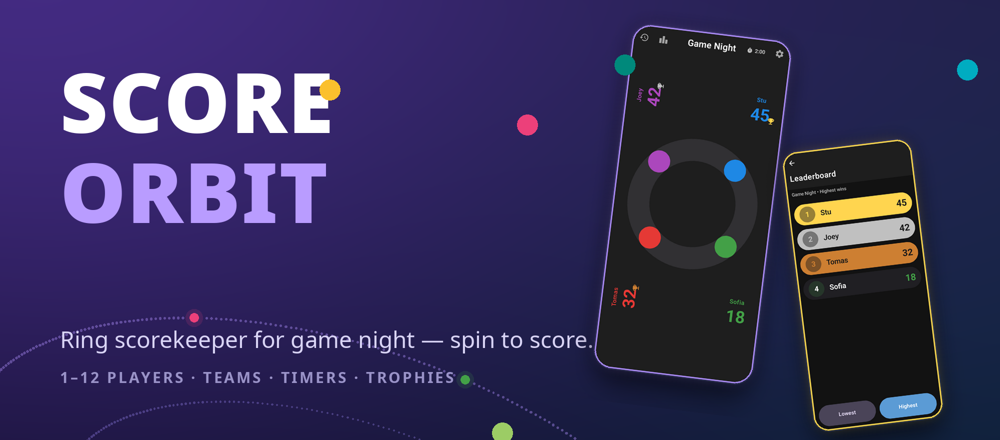
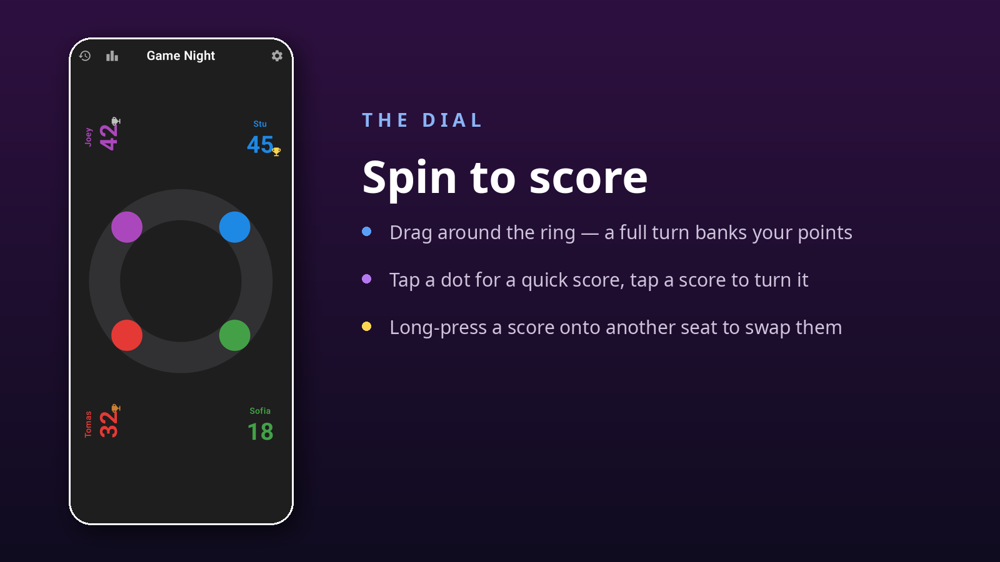
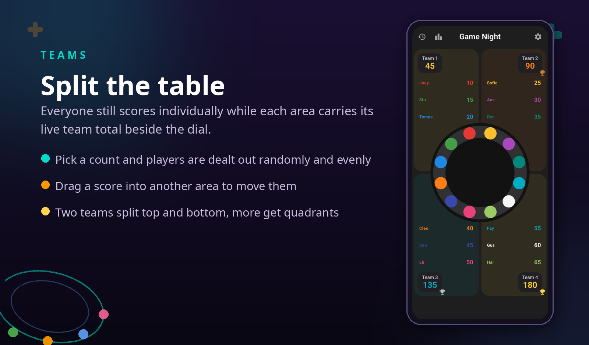
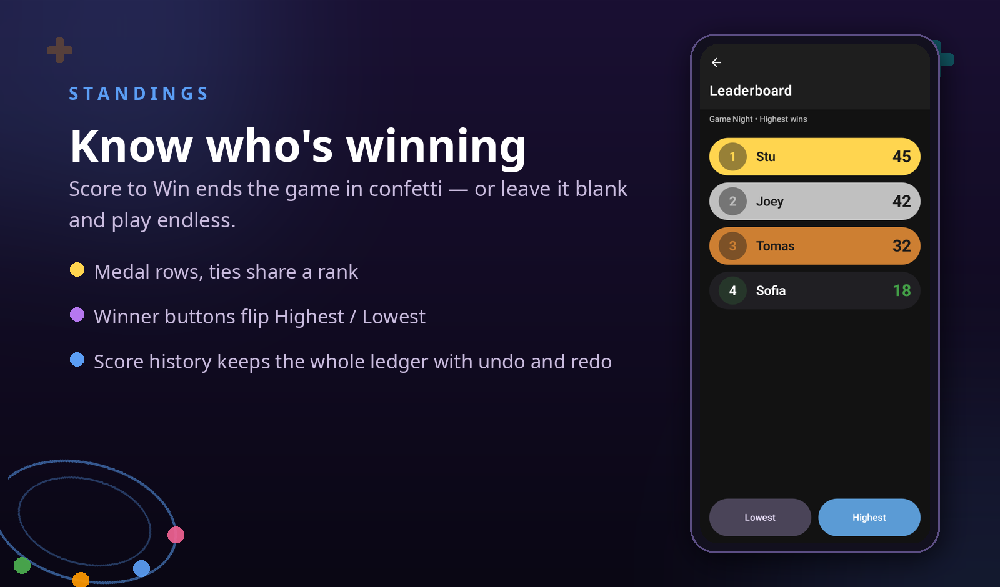
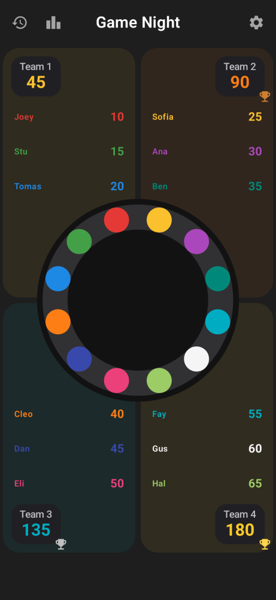

<div align="center">

<picture>
  
</picture>

[](https://github.com/hannad4/score-orbit/releases/latest)
[](https://github.com/hannad4/score-orbit/releases/latest)
[](https://github.com/hannad4/score-orbit/issues)

**[⬇ Download the latest APK](https://github.com/hannad4/score-orbit/releases/latest)** — inspired by Score Anything on iOS

</div>

<p align="center"></p>

## Contents

- [What it is](#what-it-is)
- [Spin to score](#spin-to-score)
- [Split the table](#split-the-table)
- [Know who's winning](#know-whos-winning)
- [Everything else](#everything-else)
- [Screens](#screens)
- [Download](#download)
- [Build from source](#build-from-source)
- [Feedback](#feedback)
- [Acknowledgements](#acknowledgements)

## What it is

A scorekeeper for game night on Android, inspired by the Score Anything app on iOS.

Paper scorekeeping means hunting for a pen, doing arithmetic between turns, and arguing over chicken-scratch handwriting. Score Orbit puts every player on one shared dial in the middle of the table: drag around the ring the way you'd dial an old rotary phone, a full turn adds your points, and letting go snaps the dial back with a spring. Anyone can reach over and dial in their own score.

<p align="center"></p>

## Spin to score



The board stays on the table and the dial does the arithmetic. Scores sit outside the ring facing each player's seat for 1–12 players, and a long-press drag swaps any two seats with a glide transition.

<p align="center"></p>

## Split the table



Pick a team count and players are dealt out randomly and evenly. Two teams split the board top and bottom, more teams get quadrants — everyone still scores individually while each area carries its live total.

<p align="center"></p>

## Know who's winning



Trophies on the top three scores follow the Highest/Lowest setting, the leaderboard ranks everyone with medal highlights, and a Score to Win target ends the game in confetti — or leave it blank and play endless.

<p align="center"></p>

## Everything else

- ⏱ **Turn timer** — a pill in the top bar expands into a full timer strip: 15-second steps, start-pause, reset, and a progress rail that drains with the countdown. At time's up it rings until you stop it
- 🕘 **Score history** — every entry in a ledger with undo/redo, newest first
- 📳 **Gesture-safe board** — the bottom strip ignores touches, so swiping home never scores by accident
- 💾 **Never loses your game** — setup, scores, and undo history save on every change and restore on launch
- 🎨 **Adaptive everything** — system light/dark theme (or override), Material You dynamic colors on Android 12+, haptics with adjustable strength
- 🧩 **Built with Material 3 Expressive** throughout — collapsing app bars, tonal buttons, segmented controls, spring physics on the dial itself

## Screens

<p align="center">
  
  
  
</p>
<p align="center">
  
  
  
</p>

<p align="center"></p>

## Download

Grab the APK from the [releases page](https://github.com/hannad4/score-orbit/releases/latest) and sideload it — no store account needed. Each release carries two builds:

- **release** (~1 MB, signed) — daily use
- **debug** (~15 MB) — for poking around

## Build from source

```bash
./gradlew assembleDebug
```

Debug APK lands at `app/build/outputs/apk/debug/app-debug.apk`.

Release needs the local keystore in `~/.local/share/score-orbit/` (not in the repo):

```bash
./gradlew assembleRelease
```

Screenshots are generated headless with Paparazzi:

```bash
./gradlew recordPaparazziDebug
```

## Feedback

Found a bug or want a feature? [Open an issue](https://github.com/hannad4/score-orbit/issues) — that's where the roadmap lives.

## Acknowledgements

- Inspired by the Score Anything app on iOS
- Built with Material 3 Expressive components throughout
- Thanks to everyone who has filed issues and sent pull requests
