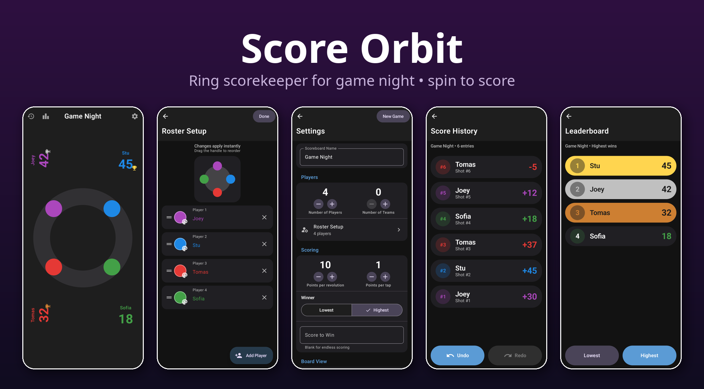
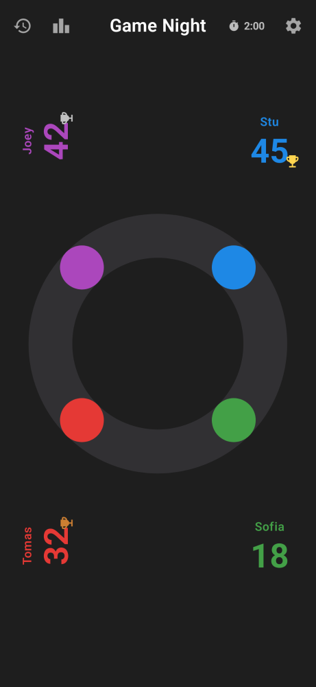
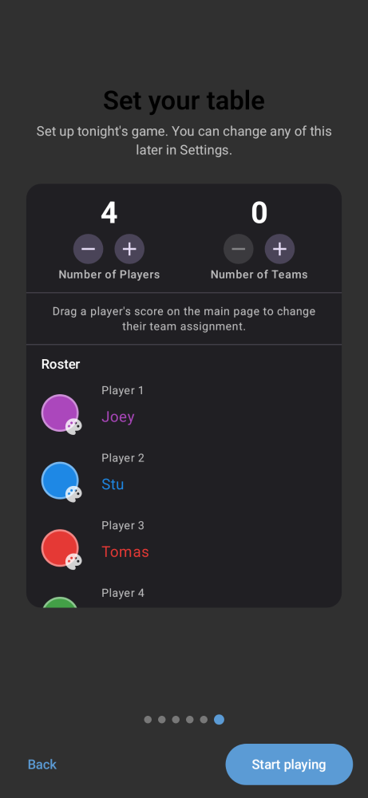
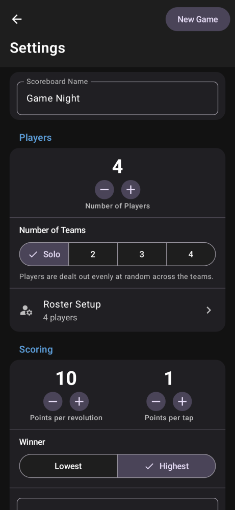
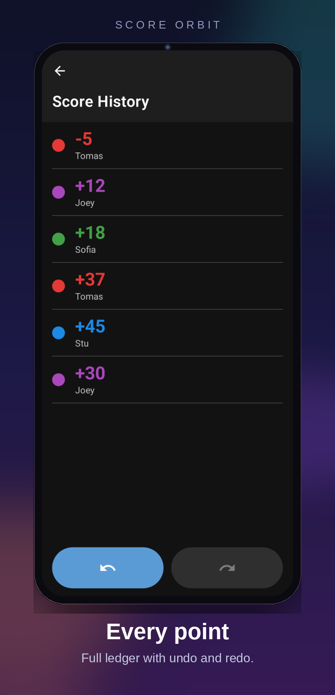
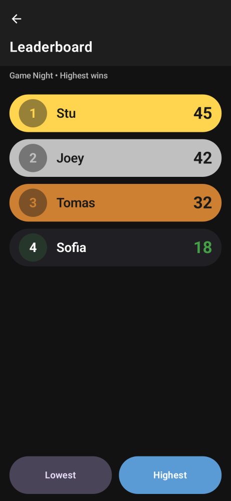

<div align="center">

# Score Orbit

Ring scorekeeper for game night — spin to score.

[](https://github.com/hannad4/score-orbit/releases/latest)
[](https://github.com/hannad4/score-orbit/releases/latest)

**[⬇ Download the latest APK](https://github.com/hannad4/score-orbit/releases/latest)**

</div>



## Contents

- [What it is](#what-it-is)
- [Features](#features)
- [Screens](#screens)
- [Download](#download)
- [Build from source](#build-from-source)
- [Feedback](#feedback)
- [Acknowledgements](#acknowledgements)

## What it is

A scorekeeper for game night on Android, inspired by the Score Anything app on iOS.

Paper scorekeeping means hunting for a pen, doing arithmetic between turns, and arguing over chicken-scratch handwriting. Score Orbit puts every player on one shared dial in the middle of the table: drag around the ring the way you'd dial an old rotary phone, a full turn adds your points, and letting go snaps the dial back with a spring. Anyone can reach over and dial in their own score.

## Features

- ☎️ **Rotary dial scoring** — drag around the ring for big points, tap a dot for quick points, tap a score to turn it toward its player
- 🔄 **Rearrange on the board** — long-press a score and drag it onto another seat to swap the two, with a glide transition
- 👥 **1–12 players** — names, colors, drag-to-reorder roster, live ring preview while you set up
- 🟪 **Teams** — pick a count and players are dealt out randomly and evenly; drag scores between tinted areas to move them, each area showing its collective total
- 🎯 **Score to Win** — set a target and the game ends in confetti, or leave it blank and play endless
- 🏆 **Rank badges** — gold/silver/bronze trophies on the top three scores (toggleable), following the Highest/Lowest setting
- 🥇 **Leaderboard** — medal cards, ties share a rank, teams and solos ranked separately
- 🕘 **Score history** — every entry in a ledger with undo/redo, newest first
- 📳 **Gesture-safe board** — the bottom strip ignores touches, so swiping home never scores by accident
- 💾 **Never loses your game** — setup, scores, and undo history save on every change and restore on launch
- 🎨 **Adaptive everything** — system light/dark theme (or override), Material You dynamic colors on Android 12+, haptics with adjustable strength

## Screens

<p align="center">
  
  
  
</p>
<p align="center">
  
  
</p>

## Download

Grab the APK from the [releases page](https://github.com/hannad4/score-orbit/releases/latest) and sideload it — no store account needed. Each release carries two builds:

- **release** (~1 MB, signed) — daily use
- **debug** (~15 MB) — for poking around

## Build from source

```bash
./gradlew assembleDebug
```

Debug APK lands at `app/build/outputs/apk/debug/app-debug.apk`.

Release needs the local keystore in `~/.local/share/score-orbit/` (not in the repo):

```bash
./gradlew assembleRelease
```

Screenshots are generated headless with Paparazzi:

```bash
./gradlew recordPaparazziDebug
```

## Feedback

Found a bug or want a feature? [Open an issue](https://github.com/hannad4/score-orbit/issues) — that's where the roadmap lives.

## Acknowledgements

- Inspired by the Score Anything app on iOS
- Built with Material 3 Expressive components throughout
- Thanks to everyone who has filed issues and sent pull requests
